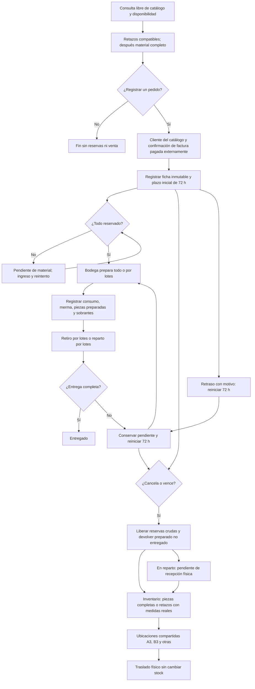

# Flujo actual

Gestión: módulos Pedidos, Rutas, Inventario, Piezas y Bodega de las apps (Windows y Android). Ver ARQUITECTURA_SERVICIOS.md.

## Servicios

| Servicio | Responsabilidad |
|---|---|
| Usuarios | Identificación, contraseñas, roles, sesiones y administración |
| Inventario | Catálogo, movimientos y saldos; protección de reservas |
| Retazos | Piezas físicas, dimensiones, porcentajes, cortes y genealogía |
| Pedidos | Clientes, pedido ya confirmado, reservas, lotes, plazo, devoluciones e historial |
| Ubicaciones | Espacios compartidos, distribución y movimientos físicos |
| Logística | Funciones existentes de conductores, rutas, GPS y evidencias |
| Gateway | Entrada web/API, puerto 8080 |
| PostgreSQL/PostGIS | Una base persistente, esquemas por dominio |

Cada retiro/entrega parcial o retraso documentado reinicia 72 horas para lo pendiente. Consultar, preparar, despachar o reintentar no lo renuevan. Lo ya entregado no vuelve automáticamente al inventario. La merma no se recupera. El proceso de vencimiento comprueba cada segundo mientras Pedidos está activo y recupera vencidos al arrancar.

## Fuera del alcance acordado

Pagos, anticipos, crédito, impuestos, descuentos y facturación tributaria. La referencia de una factura externa y la confirmación del operador no constituyen un módulo financiero. La tabla automática de precios se revisará cuando esté disponible.

## Pendientes reales

- Sincronización automática de pedidos con rutas, conductores y evidencias de Logística. Actualmente la salida/entrega es un registro administrativo; su entidad histórica `logistica.pedidos` no es la ficha comercial.
- Completar seguridad por sesión/roles de Logística antes de exponerla a trabajadores externos.
- Abastecimiento/avisos de faltantes, carga Excel e integración con el inventario empresarial.
- Conectar la aplicación de trabajadores a estas APIs y definir la tabla de trabajos/precios.
- Si se requiere, elección explícita del estante en cada salida de productos generales: hoy la distribución se reduce en orden estable. Múltiples bodegas independientes tampoco se implementaron.

La ficha sigue sin edición, por decisión del negocio. Entregas/preparaciones parciales, vencimiento, devolución del preparado, catálogo de clientes y ubicaciones compartidas ya están implementados.

Detalle: [Pedidos](services/pedidos-service/README.md), [Ubicaciones](services/ubicaciones-service/README.md).
