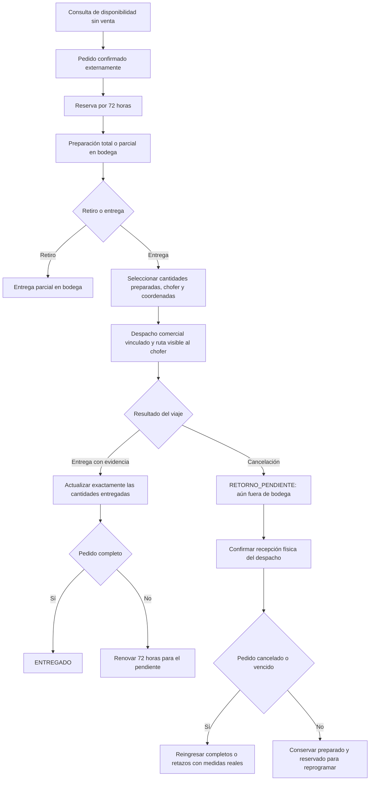

# Pedidos comerciales y logística

## Flujo implementado



## Uso

Desde `/pedidos/`, abrir el pedido, preparar el material e indicar las cantidades de cada línea. Para enviar a reparto, seleccionar un chofer activo con contraseña definitiva y proporcionar latitud/longitud del destino. El nombre y dirección salen de la ficha comercial; el receptor es opcional y queda en el historial del lote.

Cada despacho crea una ruta de una parada con código `PED-<shipmentId>`. Aparece en la aplicación del chofer y en el administrador. El móvil actualiza sus rutas cada ocho segundos como respaldo a WebSocket. La ruta conserva su relación con el pedido: no se permite borrarla, cambiar el destino ni reemplazar su chofer desde los controles de rutas genéricas. Para reprogramar, cancelar el viaje, recibir el material y crear otro despacho.

La entrega del despacho registra todas las cantidades de ese lote. Las entregas parciales del pedido se representan mediante distintos despachos; pueden llegar en diferente orden. Repetir una confirmación no vuelve a descontar stock ni duplica las cantidades entregadas.

Cancelar un viaje no cancela la venta. El material queda pendiente de retorno físico. Si la venta sigue activa, recibir el lote lo deja preparado y reservado para el mismo cliente; no se ofrece como stock libre. Si la venta se canceló o venció, la recepción física lo devuelve al inventario con sus medidas reales. Las piezas ya entregadas no se devuelven automáticamente.

Cancelar o vencer el pedido cancela sus repartos pendientes. No se permite iniciar o cerrar entregas de pedidos vencidos, cancelados o retrasados. Cada entrega parcial renueva 72 horas; despachar y recibir un retorno no renuevan el plazo por sí mismos.

## API

| Operación | Ruta |
|---|---|
| Choferes disponibles para seleccionar | `GET /api/pedidos/shipping-drivers` |
| Despachos del pedido | `GET /api/pedidos/orders/{id}/shipments` |
| Crear despacho y ruta vinculados | `POST /api/pedidos/orders/{id}/shipments` |
| Recibir el lote completo que regresa | `POST /api/pedidos/shipments/{id}/receive-return` |
| Confirmar entrega y actualizar el pedido | `POST /api/v1/logistica/despachos/{id}/cerrar-entrega` |

Crear despacho requiere `requestId`, `driverId`, `latitude`, `longitude`, `lines` (`lineId`, `quantity`), `reason` y opcional `receiverName`. El mismo `requestId` y contenido devuelve el despacho existente; reutilizarlo con otro contenido responde 409. Solo administrador o bodeguero crean y reciben despachos. Para operar un reparto comercial, logística valida la sesión y admite al chofer asignado o a un administrador. Las claves temporales y cuentas desactivadas no operan.

Los endpoints manuales antiguos de reparto permanecen por compatibilidad, pero no crean rutas vinculadas. Para el flujo integrado usar el portal actualizado o `/shipments`; no combinar entregas manuales con cantidades que están en un despacho vinculado.

## Persistencia y consistencia

La integración usa la única base PostgreSQL compartida acordada. `pedidos.commercial_shipment` identifica pedido, ruta y despacho; `pedidos.shipment_item` vincula cada cantidad con su lote o pieza preparada exacta. No depende de encontrar un pedido por nombre de cliente.

Crear un despacho comercial y su ruta ocurre en una transacción JDBC. Al confirmar la entrega, el contrato SQL de pedidos participa en la misma transacción JPA de logística: o se guardan la evidencia, los estados y las cantidades, o se revierte todo. La entrega no descuenta stock otra vez: ese consumo ya se registró al preparar.

La integración depende del contrato de base compartida, no de HTTP entre ambos servicios. Si se separan las bases en el futuro habrá que sustituirla por eventos persistentes y reintentos. Si la base falla, la operación se revierte; no se informa una entrega comercial exitosa sin haberla guardado.

## Pruebas reproducibles

```powershell
. .\scripts\mobile-env.ps1
.\scripts\test-all.ps1
python scripts/test-pedidos-logistica.py
python scripts/smoke-platform.py
.\scripts\test-admin-windows.ps1
```

La prueba HTTP crea un chofer, cliente, producto y pedidos QA identificados, comprueba entregas fuera de orden, reintentos, cancelación, recepción física, reprogramación y vencimiento, y limpia únicamente sus registros al finalizar. Las sesiones de prueba se revocan. Las pruebas de cortes verifican el retorno de la pieza exacta y la conservación de sobrantes.

Las evidencias HTTP son sintéticas: comprueban persistencia y reglas, no certifican una fotografía o presencia GPS real. La captura de foto del móvil sigue simulada; la prueba de campo y la captura real son un trabajo distinto a esta integración.
